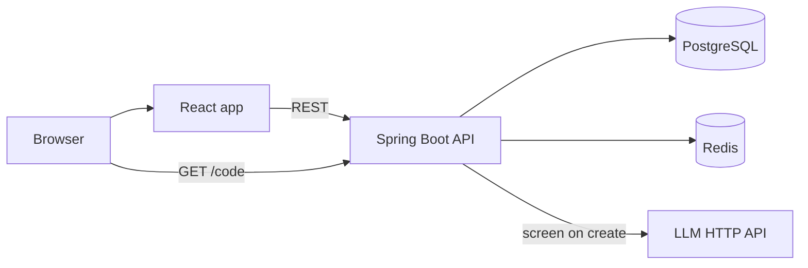
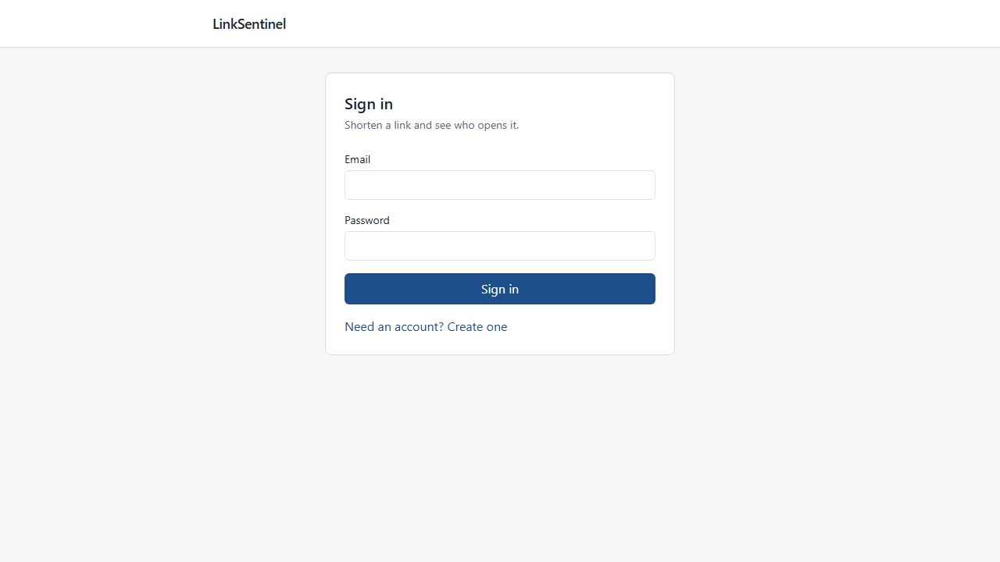
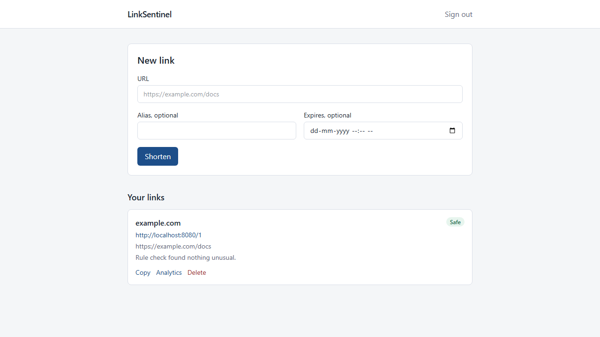
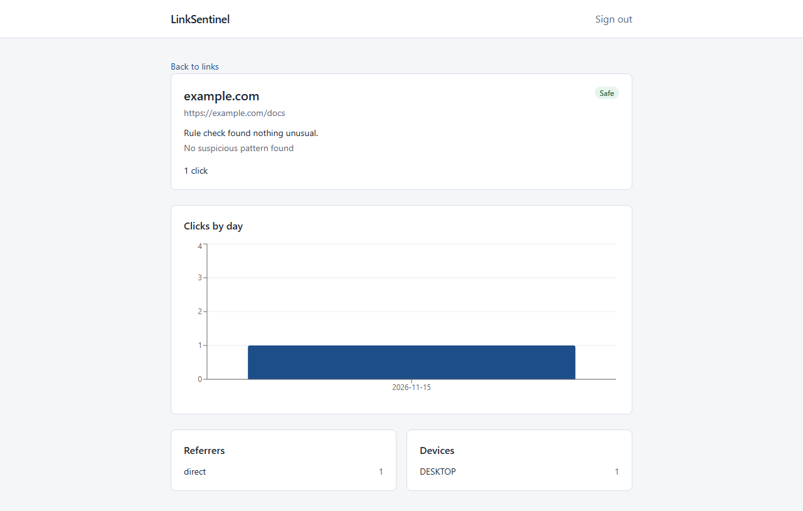

# LinkSentinel

A URL shortener for people who want a short link, a fast redirect, and a record of what was clicked. Creating a link also asks a model whether the URL looks like phishing or spam. If that call fails, a small rule check still fills in a verdict and the link is created anyway.

Public shorteners get slow when every redirect hits the database, and they get used to hide bad links. LinkSentinel keeps the code-to-URL mapping in Redis, limits how fast a caller can hit the API, and screens the URL once at creation time. The redirect itself never waits on the model or on the click insert.

## Architecture



Register and login return a JWT. Authenticated calls create, list, and delete links, and read click stats. `GET /{code}` is public: it reads Redis, falls back to Postgres, answers 302, and hands the click to a virtual thread. Screening runs only inside link creation. The verdict is cached in Redis under the SHA-256 of the URL.

## Setup

Requirements: Docker with Compose, or a JDK 25 toolchain if you only want to run the tests. The app is Java 25 and Spring Boot 4.1.2.

```bash
copy .env.example .env
```

Set `JWT_SECRET` to at least 32 characters. Leave `LLM_API_KEY` empty to use the rule checker, or set `LLM_BASE_URL`, `LLM_API_KEY`, and `LLM_MODEL` for any OpenAI-compatible chat completions endpoint.

On startup the API creates a demo user when `DEMO_EMAIL` and `DEMO_PASSWORD` are both set. The defaults are `demo@linksentinel.local` and `password123`. Sign in with those on the login page. If that email already exists, the password is left as it is.

```bash
docker compose up --build
```

The UI is at http://localhost:5173, the API at http://localhost:8080, and Swagger UI at http://localhost:8080/swagger-ui.html.

The Compose file publishes Postgres 18.7 and Redis 8.10.3. The backend test run on 17 Nov 2026 used embedded Postgres 18.6 and embedded Redis, because the Docker engine was not available in that test process. The same day, `docker compose up --build` started the real images: Postgres 18.7, Redis 8.10.3, the API, and the UI. A fuller write-up is in `docs/LinkSentinel-Documentation.pdf`.

## API

| Method | Path | Auth | What it does |
| --- | --- | --- | --- |
| POST | `/api/auth/register` | no | Create an account. 201 and a JWT. Duplicate email is 409. |
| POST | `/api/auth/login` | no | 200 and a JWT. Bad credentials are 401. |
| POST | `/api/links` | JWT | Body: `url`, optional `alias`, optional `expiresAt`. 201. Bad URL or past expiry is 400. Alias taken is 409. |
| GET | `/api/links` | JWT | Links owned by the caller. |
| DELETE | `/api/links/{code}` | JWT | 204. Someone else's code is 404. |
| GET | `/api/links/{code}/stats` | JWT | Click count, clicks by day, referrers, devices, screening verdict. |
| GET | `/{code}` | no | 302 to the target. Unknown code is 404. Expired link is 410. |

Errors are JSON: `error`, `message`, and `fields` when validation failed. A rate limit response is 429 and includes `Retry-After`.

Short codes are base62. An alias must be 3 to 32 letters or digits. `api`, `v3`, `error`, `actuator`, and `swagger` are reserved so they do not shadow the API.

## Tests

Backend, from `backend`:

```bash
./mvnw test
```

On Windows that is `.\mvnw.cmd test`. Surefire runs unit tests, the `*IT` integration tests, and the redirect load test.

Frontend, from `frontend`, with the API already listening on port 8080 for the end-to-end test:

```bash
npm test
npm run e2e
```

`npm test` is Vitest. `npm run e2e` is one Playwright flow: create an account, shorten `https://example.com/docs`, and see that URL in the list. The API has to be on port 8080 before the Playwright run.

### Measured on 17 Nov 2026

`.\mvnw.cmd test` in `backend`: 19 tests, 0 failures. Docker was not running, so Postgres and Redis were the embedded fallback (Postgres 18.6). The log line was `Integration services: embedded Postgres and Redis (Docker engine is not running)`.

Redirect load, 400 requests, 25 in flight, 30 warmup requests, HTTP 302 only, same JVM:

| Mode | p50 | p95 | requests/sec | errors |
| --- | --- | --- | --- | --- |
| Redis cache on | 176.26 ms | 616.50 ms | 104.1 | 0 |
| Cache off, Postgres read | 214.27 ms | 399.31 ms | 110.0 | 0 |

Source lines, written by the test to `backend/target/load-cached.txt` and `backend/target/load-uncached.txt`:

```
mode=cached requests=400 concurrency=25 p50_ms=176.26 p95_ms=616.50 rps=104.1 errors=0
mode=uncached requests=400 concurrency=25 p50_ms=214.27 p95_ms=399.31 rps=110.0 errors=0
```

The cache lowered the median. On this run the tail and the requests/sec did not; both modes share one JVM and both still write clicks to Postgres.

Frontend, 15 Nov 2026: `npm test` ran Vitest 5.1.0, 3 files, 5 tests, 0 failures, 14.91s. `npm run e2e` ran Playwright, 1 test, passed in 20.9s. That run saved the screenshots below. The API for that run was this app on port 8080 with the rule checker, because no LLM key was set.

## Screenshots

Sign in:



A shortened link, with the rule-check verdict:



Clicks for that link:



## Design decisions

Screening uses `RestClient` against `/v1/chat/completions` rather than Spring AI. The process starts with no API key, and a timeout or a bad response falls back to host blocklist and a few URL patterns. Unsafe links are still stored. The badge is the warning. The model is never called from the redirect.

The token bucket lives in two places that have to stay in step: `TokenBucket` (unit tested) and `redis/token_bucket.lua` (what production runs, atomically). The Redis key includes the bucket size so a config change does not keep spending an old bucket.

Redirects use cache-aside. The value is the link id and the URL, and the TTL is the shorter of `CACHE_TTL` and the time left before expiry. Click rows are inserted on a virtual-thread executor after the 302 is decided. The Hikari pool is 20 so those inserts have room next to redirect reads.

The JWT filter and the rate-limit filter are registered only on the security chain. If they were also servlet filters, the limiter would see an anonymous caller and then skip its second run.

## Limits

The rate limit key is the user id after login, otherwise the socket address. It does not read `X-Forwarded-For`. A click still in the executor can be lost if the process stops. Editing a row in SQL does not evict Redis; delete through the API does. The rule checker is a short pattern list, not a reputation feed. The UI stores the JWT in `localStorage`. The frontend image is built with `VITE_API_URL=http://localhost:8080`, so the browser calls the published API port on the host.
